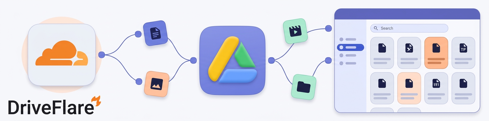

# DriveFlare



A single-file Cloudflare Worker that turns a Google Drive (or a subset of folders / shared drives) into a self-hosted, multi-user file browser — with its own login system, previews, sharing, stars, and an admin panel. No build step, no framework, no database beyond Workers KV.

```
┌─────────────┐      ┌──────────────────┐      ┌──────────────┐
│  Browser    │ ───► │  Cloudflare      │ ───► │ Google Drive │
│  (SPA)      │      │  Worker + KV     │      │  v3 API      │
└─────────────┘      └──────────────────┘      └──────────────┘
```

---

## Features

- **Multi-user login** — email + password accounts stored in KV; first account is an admin.
- **Multiple locations** — expose the Drive root, specific folders, or whole shared drives, each as a separate "disk".
- **File browser** — grid / list views, breadcrumbs, folder navigation, infinite scroll pagination.
- **Previews** — images, video, audio, PDF, plain text, and an in-browser **ZIP browser** (list & extract entries up to 25 MB).
- **Search** — scoped to each configured location, with path reconstruction.
- **Starred & Recent** — per-user, synced to the server (with `localStorage` cache).
- **Sharing**
  - **People** — share a file to another app user; it appears in their *Shared* tab.
  - **Anyone with the link** — expiring public links (1 day / 7 days / 30 days / never).
- **Admin panel** — manage users, edit-access flags, locations, project name and favicon.
- **File-link protection** — optional per-location toggle so direct `/file/...` URLs require a signed-in user.
- **Theming** — light / dark / system, accent hue picker, grid/list layout, all persisted client-side.
- **Zero build** — one `.js` file, template literals for HTML, Tailwind via CDN, Material Symbols icons.

---

## Requirements

- A [Cloudflare Workers](https://workers.cloudflare.com/) account (free tier works).
- A **Workers KV namespace** bound to the Worker as `gdrive`.
- A **Google OAuth client** (installed app / web) with:
  - `client_id`
  - `client_secret`
  - a **refresh token** granting at least `https://www.googleapis.com/auth/drive.readonly`

> DriveFlare only ever **reads** from Drive. It never writes, moves, or deletes anything in your Drive.

---

## Deploy

### 1. Create the Worker

Either paste [`src/workers.js`](src/workers.js) into the Cloudflare dashboard editor, or use Wrangler:

```toml
# wrangler.toml
name = "driveflare"
main = "src/workers.js"
compatibility_date = "2024-01-01"

[[kv_namespaces]]
binding = "gdrive"
id = "<your-kv-namespace-id>"
```

```bash
wrangler deploy
```

### 2. Bind the KV namespace

In the Cloudflare dashboard: **Workers & Pages → your Worker → Settings → Bindings → Add → KV namespace**, set the variable name to exactly:

```
gdrive
```

(Or use the `wrangler.toml` snippet above.)

### 3. Run the guided setup

Open your Worker URL in a browser. On a fresh deployment you'll be redirected to `/setup`, which walks you through:

1. **Welcome** — read the setup notes and bind `gdrive`.
2. **Storage check** — verifies the KV binding.
3. **Name** — project name (defaults to *DriveFlare*) and optional favicon URL.
4. **Admin** — first administrator email + password.
5. **Drive** — OAuth credentials and the locations to expose.
6. **Finish** — validates credentials and folder/drive IDs, then writes to KV.

Once `drive_token`, `dirs`, and `users` exist, `/setup` stops responding (returns 404). **Finish setup right after deploying** — anyone who can reach a fresh deployment can configure it.

---

## Getting a Google refresh token

Any standard OAuth "installed app" flow works. Roughly:

1. Create an OAuth client in the [Google Cloud Console](https://console.cloud.google.com/apis/credentials) (type: *Desktop app*).
2. Enable the **Google Drive API** for the project.
3. Authorize with scope `https://www.googleapis.com/auth/drive.readonly` (or broader if you need to browse folders you don't own but have access to — `drive` scope covers shared drives).
4. Exchange the returned authorization code for a refresh token:

```bash
curl -s https://oauth2.googleapis.com/token \
  -d client_id=YOUR_CLIENT_ID \
  -d client_secret=YOUR_CLIENT_SECRET \
  -d code=AUTH_CODE \
  -d grant_type=authorization_code \
  -d redirect_uri=urn:ietf:wg:oauth:2.0:oob
```

The `refresh_token` in the response is what the setup page asks for.

---

## Locations

Each location is one of:

| Type          | ID                                   | Notes                                              |
| ------------- | ------------------------------------ | -------------------------------------------------- |
| `root`        | `root`                               | The authenticated user's My Drive root.            |
| `folder`      | Google Drive folder ID               | A specific folder (must be a folder, not a file).  |
| `shared_drive`| Shared drive ID                      | A whole shared drive.                              |

Location IDs are validated during setup. You can add, edit, or remove locations later from the **Manage → Locations** panel (admins only). The `protect_file_link` option on a location makes direct `/file/...` URLs require an authenticated session.

---

## Accounts & roles

- Stored under the KV key `users` as a JSON array: `{ email, password, allowedit }`.
- **Passwords are stored as entered** — no hashing. Restrict access to your KV namespace and Cloudflare account, and consider this deployment a trusted-user tool rather than a public service.
- Users with `allowedit: true` can manage users and locations. There must always be at least one editor; you can't delete or demote yourself out of edit access.
- Sessions are signed HMAC cookies (`sid`), 30-day expiry, one cookie entry per account (multi-account switching is supported via `X-U` / `?u=`).

---

## Limitations

- **Google Docs / Sheets / Slides** (native Google formats) are hidden by design — they can't be downloaded as raw files, so only folders and binary files are listed.
- **ZIP preview** is capped at 25 MB and doesn't support Zip64 or encrypted entries.
- **Search** requires at least 2 characters and matches file names (`name contains`), up to 5 terms.
- **Access-token cache** and **login rate limits** are per-Worker-instance and not globally consistent.
- **No refresh-token rotation** handling — if Google revokes the refresh token, you'll need to update credentials (re-run setup by clearing the keys).

---

## License

MIT — see [`LICENSE`](LICENSE).

---

## Acknowledgements

- Google Drive API v3
- Cloudflare Workers & KV
- Tailwind CSS (CDN), Roboto Flex, Material Symbols
- The drive icon is embedded as an inline SVG in `src/workers.js`.
